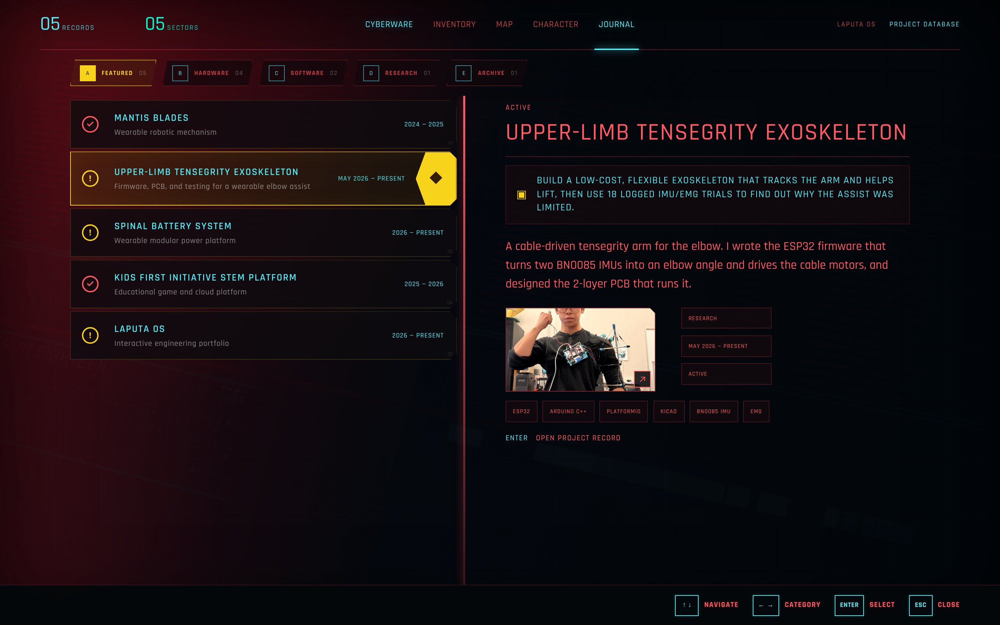

# Laputa OS

**An interactive engineering portfolio built as a fictional operating system.**
Live at **[vincentrle.dev](https://vincentrle.dev)** · Next.js · React · TypeScript



## Overview

I'm a computer engineering student at Cal Poly, and most of my work is in hardware and firmware. I built Laputa OS so my portfolio would be an engineering project in its own right, not a filled-in template. The interface takes its visual direction from the menus in Cyberpunk 2077.

Every window, menu and HUD element is a hand-written React component. All content (projects, experience, gallery, journal) lives in typed data files, so I can update the site without touching the UI.


## Features

| Area | What it does |
| --- | --- |
| **Window shell** | `/home` keeps the window state. Routes like `/projects` and `/contact` redirect into it with a hash, so each section has a shareable link and the back button still works. |
| **Typed content** | Projects, experience, gallery and journal entries are TypeScript records in `src/data/`. A validation script checks that every referenced image exists and every cross-link is valid. |
| **Live data** | The patch-notes window shows recent commits from the GitHub API, and the music panel shows Spotify activity. Both go through server routes, so no tokens reach the browser. |
| **Contact form** | Server-side validation, a request-size cap, per-IP rate limiting and a honeypot field. Mail is sent through Resend. |
| **Accessibility** | Arrow keys, Enter and Esc navigation, focus trapping inside open windows, and support for reduced motion. |
| **Performance budget** | After each build, a script fails if the home page's initial JavaScript exceeds 600 KiB or if heavy windows stop being lazy-loaded. |


## Getting started

Requires Node.js 20 or newer.

```bash
git clone https://github.com/ShortVincentMan/laputa.git
cd laputa
npm ci
npm run dev
```

Then open http://localhost:3000. The site runs without any API keys. Only the contact form, the GitHub feed and the Spotify panel need the environment variables below.

### Environment variables

Add these to `.env.local`. None use the `NEXT_PUBLIC_` prefix, so they stay on the server.

| Variable | Used by | Required |
| --- | --- | --- |
| `RESEND_API_KEY`, `CONTACT_EMAIL` | Contact form | Yes |
| `CONTACT_FROM_EMAIL` | Contact form | No |
| `GITHUB_OWNER`, `GITHUB_REPO` | Patch-notes feed | Yes |
| `GITHUB_BRANCH`, `GITHUB_TOKEN` | Patch-notes feed | No |
| `SPOTIFY_CLIENT_ID`, `SPOTIFY_CLIENT_SECRET`, `SPOTIFY_REFRESH_TOKEN` | Music panel | Yes |

## Checks

CI runs these on every push and pull request (`.github/workflows/ci.yml`):

```bash
npx tsc --noEmit           # type check
npm run lint               # ESLint
npm run content:check      # assets and cross-links
npm run build              # production build
npm run performance:check  # JavaScript budget and lazy-loading
```

## Project structure

```text
src/app/          Pages, metadata, and API routes (contact, GitHub, Spotify)
src/components/   The HUD, menus, and each window
src/data/         Portfolio content as typed records
src/hooks/        Focus trapping, keyboard shortcuts, page visibility
src/lib/          GitHub and Spotify clients
scripts/          Content-integrity and performance-budget checks
docs/             README screenshots
```

`public/assets/reference` contains game screenshots I used as visual references while building the UI.

## Known limitations

- **Rate limiting is in memory.** On Vercel, each serverless instance keeps its own count. That's acceptable for a portfolio, but a production service would use a shared store such as Redis.
- **No unit tests yet.** Quality checks are currently the type check, lint, the content-integrity script and the performance budget.
- **Scope.** The Skills, Settings and Vehicle screens were left out of v1 on purpose. The resume is a PDF in `public/` rather than its own window.

---

<sub>Laputa OS is a fan-made portfolio. It is not affiliated with or endorsed by CD PROJEKT RED. Cyberpunk 2077 and related trademarks belong to their respective owners.</sub>
