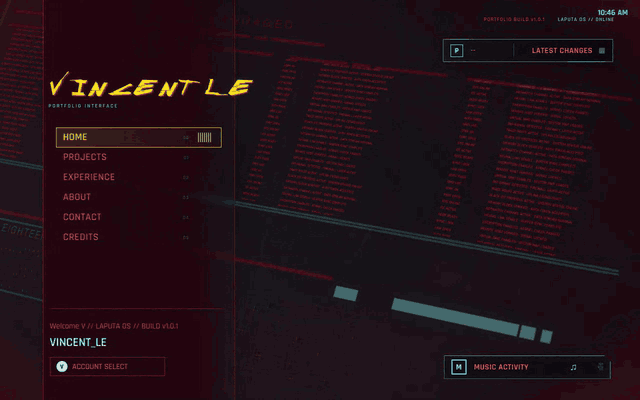
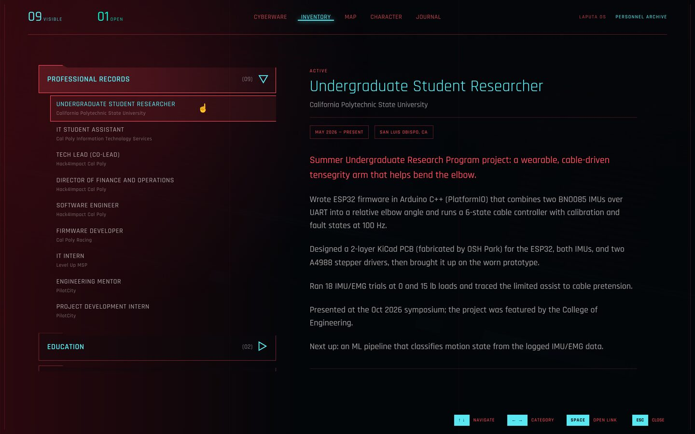

# Laputa OS

My portfolio, built as a fake operating system. It's styled after the menus in Cyberpunk 2077, which I've played way too much of. It's live at **[vincentrle.dev](https://vincentrle.dev)**.


I'm a computer engineering student at Cal Poly, and most of my work is hardware and firmware. I wanted a portfolio that felt like something I built rather than a template I filled in. So every window, menu and HUD element here is a hand-written React component, and all the content (projects, experience, gallery, journal) lives in typed data files I can update without touching the UI.



## What's in it

- **A windowed shell.** `/home` keeps the window state. Routes like `/projects` and `/contact` redirect into it with a hash, so every section has a link you can share and the back button still works.
- **Typed content.** Projects, experience, gallery and journal entries are TypeScript records in `src/data/`. A script checks that every image they reference actually exists and that cross-links between records are valid.
- **Live data.** The patch-notes window pulls my latest commits from the GitHub API, and the music button shows what I'm listening to on Spotify. Both go through server routes, so no tokens reach the browser.
- **A contact form that holds up to spam.** It checks the input on the server, caps the request size, rate-limits by IP, has a honeypot field, and sends mail through Resend.
- **Keyboard and accessibility.** You can move around with the arrow keys, Enter and Esc. Focus stays inside open windows, and animations turn off if you've set reduced motion.
- **A performance budget.** After a build, a script fails if the home page's initial JavaScript goes over 600 KiB or if heavy windows stop being lazy-loaded.



## Things I'd do differently / know about

- The rate limit lives in memory, so on Vercel each serverless instance keeps its own count. That's fine for a portfolio, but a real product would use a shared store like Redis.
- There are no unit tests yet. The checks are type checking, lint, the content-integrity script and the performance budget, and they all run in CI on every push.
- Skills, Settings and Vehicle screens were cut from v1.0 on purpose. My resume is a PDF in `public/` instead of its own window.

## Running it

You need Node 20 or newer.

```bash
git clone https://github.com/ShortVincentMan/laputa.git
cd laputa
npm ci
npm run dev
```

Then open http://localhost:3000. Everything works without API keys except the contact form, the GitHub feed and Spotify. For those, add these to `.env.local`:

```text
RESEND_API_KEY, CONTACT_EMAIL, CONTACT_FROM_EMAIL (optional)
GITHUB_OWNER, GITHUB_REPO, GITHUB_BRANCH (optional), GITHUB_TOKEN (optional)
SPOTIFY_CLIENT_ID, SPOTIFY_CLIENT_SECRET, SPOTIFY_REFRESH_TOKEN
```

None of these use the `NEXT_PUBLIC_` prefix, so they never ship to the browser.

## Checks

```bash
npx tsc --noEmit
npm run lint
npm run content:check
npm run build
npm run performance:check
```

These are the same checks CI runs (`.github/workflows/ci.yml`).

## Layout

```text
src/app/          Pages, metadata, and API routes (contact, GitHub, Spotify)
src/components/   The HUD, menus, and each window
src/data/         All the portfolio content, as typed records
src/hooks/        Focus trapping, keyboard shortcuts, page visibility
src/lib/          GitHub and Spotify clients
scripts/          Content-integrity and performance-budget checks
docs/             Screenshots for this README
```

`public/assets/reference` has game screenshots I used as visual references while building the UI.

---

Laputa OS is a fan-made portfolio. It isn't affiliated with or endorsed by CD PROJEKT RED. Cyberpunk 2077 and related trademarks belong to their owners.
